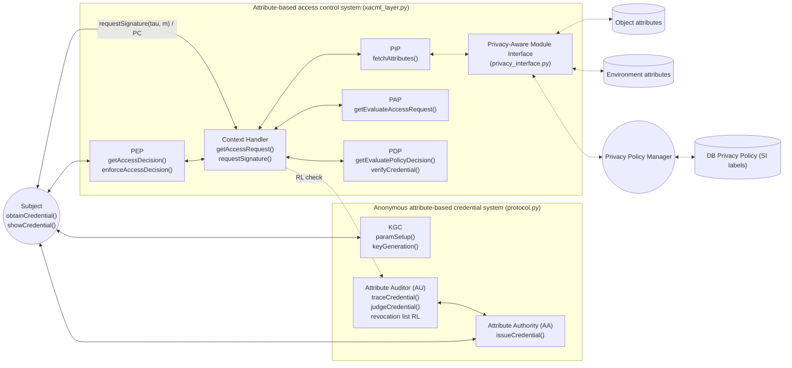
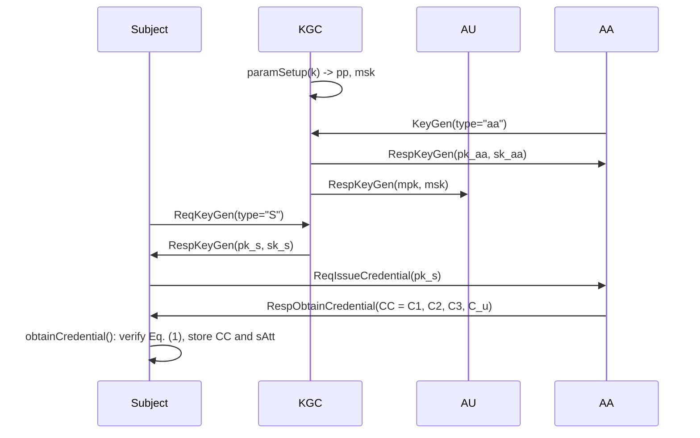
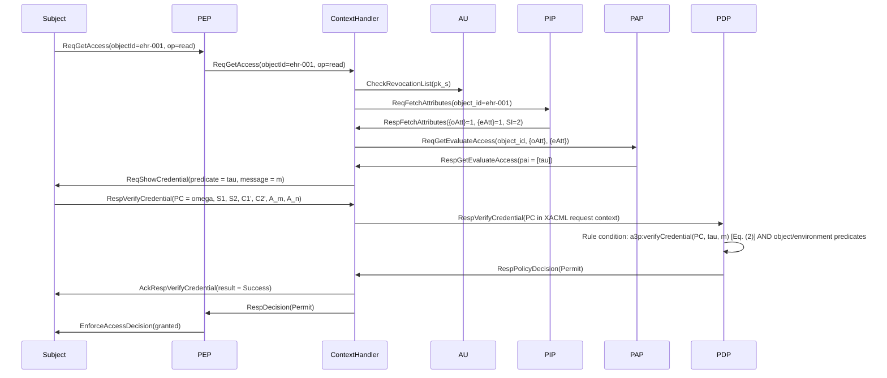

# A3P-FACS: API and XACML Integration Specification

This document specifies, component by component, the interfaces (APIs), the messages exchanged, and how anonymous credential verification is embedded in XACML policy evaluation in A3P-FACS. It follows:

- **Figure 2** (*Implementation Model of A3P-FACS*) for the components and their functions;
- **Section 5** (*A3P-FACS: The Proposed Protocol*) for the algorithms and equations;
- **Figure 3** (*Implemented sequence diagram of A3P-FACS*) for the message names and their order.

Every interface listed here is implemented in this repository and exercised by `test_protocol.py` and `test_xacml.py`. `demo.py` runs a complete session and prints the message trace and the stored XACML policy.

---

## 1. Architecture and source-code map

A3P-FACS has two subsystems connected by the context handler:

1. **Anonymous attribute-based credential system:** KGC, AA, AU and the Subject.
2. **Attribute-based access control system:** PEP, context handler, PIP with the privacy-aware module interface, PAP and PDP.



| Figure 2 component | Function(s) in Figure 2 | Class / function in code | File |
|---|---|---|---|
| Key Generation Centre (KGC) | `paramSetup()`, `keyGeneration()` | `KeyGenerationCenter.param_setup`, `.key_generation_subject`, `.key_generation_aa` | `protocol.py` |
| Attribute Authority (AA) | `issueCredential()` | `AttributeAuthority.issue_credential` | `protocol.py` |
| Attribute Auditor (AU) | `traceCredential()`, `judgeCredential()` | `AttributeAuditor.trace_credential`, `.judge_credential`, `.identify`, `.revoke`, `.is_revoked` | `protocol.py` |
| Subject | `obtainCredential()`, `showCredential()` | `Subject.obtain_credential`, `.show_credential` | `protocol.py` |
| PEP | `getAccessDecision()`, `enforceAccessDecision()` | `PolicyEnforcementPoint.get_access_decision`, `.enforce_access_decision` | `xacml_layer.py` |
| Context Handler | `getAccessRequest()`, `requestSignature()` | `ContextHandler.get_access_request`, `.request_signature` | `xacml_layer.py` |
| PIP | `fetchAttributes()` | `PolicyInformationPoint.fetch_attributes` | `xacml_layer.py` |
| Privacy Aware Module Interface | sensitivity-based minimisation | `PrivacyAwareModuleInterface.minimise` | `privacy_interface.py` |
| Privacy Policy Manager / DB Privacy Policy | SI labelling | `PrivacyPolicyManager.label`, `.sensitivity_of` | `privacy_interface.py` |
| PAP | `getEvaluateAccessRequest()` | `PolicyAdministrationPoint.get_evaluate_access_request` | `xacml_layer.py` |
| PDP | `getEvaluatePolicyDecision()`, `verifyCredential()` | `PolicyDecisionPoint.get_evaluate_policy_decision`, `.verify_credential` (XACML function `a3p:verifyCredential`) | `xacml_layer.py` |
| Object / environment attribute store | storage layer | `ResourceRecord`, `A3PFACSSystem.store` | `privacy_interface.py`, `system.py` |
| LSSS access structure (M, p) | Section 5.3 | `build_access_structure`, `reconstruction_vector` | `lsss.py` |
| System wiring (all phases) | — | `build_system`, `A3PFACSSystem.enrol_subject` | `system.py` |

---

## 2. Data types exchanged between components

| Type | Content (paper notation) | Created by | Consumed by | Code |
|---|---|---|---|---|
| Public parameters `pp` | `(G1, G2, GT, e, mpk1 = g1^α, g1, g2, U, H1, H2)`; contains no secret. `mpk2 = g2^−α` is kept by the AU and is **not** published | KGC | all | `PublicParameters` |
| Master secret key `msk` | `α` | KGC | AU only | `AuditorKey` |
| Subject key pair | `sk_s`; `pk_s = (pk_s1 = g1^sk_s, pk_s2 = e(g1,g2)^sk_s)` | KGC | Subject; AA (public part) | `SubjectKey`, `SubjectPublicKey` |
| AA key pair | `sk_aa = (sk_aa1, sk_aa2 = g1^sk_aa1)`; `pk_aa = (pk_aa1 = e(g1,g2)^sk_aa1, pk_aa2 = g2^{−α·sk_aa1})` | KGC | AA; Subject, PDP, AU (public part) | `IssuerKey`, `IssuerPublicKey` |
| Credential certificate `CC` | `C1 = sk_aa2·pk_s1^{1/H(sAtt)}·mpk1^r`, `C2 = g1^−r`, `C3 = g2^r`, `C_u = {U_att^r}` | AA | Subject (kept private with `sAtt`) | `Credential` |
| Access predicate `τ` and structure `(M, p)` | monotone AND/OR formula → LSSS matrix and row labelling | PAP | Subject, PDP | `AccessStructure` |
| Session message `m` | fresh random challenge per request | Context handler | Subject, PDP | `int` |
| Presentation certificate `PC` | `(Ω = {w_i}, S1, S2, C1′, C2′, A_m, A_n)` with a fresh δ in `S1` and `A_n` and an independent `r″` in the tracing pair `(C1′, C2′)`; **no attribute names or values and no per-subject constant** | Subject | PDP (via context handler), AU | `PresentationCertificate` |
| Released attribute view | SI-minimised `{oAtt}`, `{eAtt}` | PIP (privacy module) | Context handler, PAP, PDP | `ReleasedAttributeView` |
| XACML policy | Target (resource, action) + Rules (Effect, Condition) | PAP | PDP | `Policy`, `Rule`, `policy_to_xacml` |
| XACML request context | attribute categories (Section 4.2) | Context handler | PDP | `RequestContext` |
| Decision | `Permit` / `Deny` / `NotApplicable` / `Indeterminate`, status, credential-check results | PDP | Context handler → PEP | `Decision` |
| Identity proof `β*` | `C1′·(C2′)^α` | AU | AU (judge) | G1 point |

The hash functions follow Section 5.2: `H1: {0,1}* → G1` (RFC 9380, `BLS12381G1_XMD:SHA-256_SSWU_RO_`), `H2: G1 → Z_p*` (SHA-256), `H(att) = H2(H1(att))`, and `H(sAtt) = ∏ H(att) mod p`, so that `H(sAtt) = H(mAtt)·H(nAtt)`.

---

## 3. Component APIs

The signatures use the paper's names, followed by the code name in brackets. *In* and *Out* list the parameters; *Message* gives the Figure 3 label.

### 3.1 Key Generation Centre (KGC): System Initialization and Access Credential Setup phases

| API | In | Out | Message (Fig. 3) | Section |
|---|---|---|---|---|
| `paramSetup(k)` [`param_setup()`] | security parameter (BLS12-381, ≈128-bit) | `pp`, `msk = α` (to AU) | `paramSetup` | 5.1 |
| `keyGeneration(pp, "S")` [`key_generation_subject()`] | `pp` | `(pk_s, sk_s)` | `ReqKeyGen(type:"S")` / `RespKeyGen(pk_s, sk_s)` | 5.2 |
| `keyGeneration(pp, "aa")` [`key_generation_aa(pp)`] | `pp` | `(pk_aa, sk_aa)` | `KeyGen(type:"aa")` / `RespKeyGen()` | 5.2 |
| `keyGeneration(pp, "au")` | — | `(mpk, msk)` (produced by `paramSetup`) | `KeyGen(type:"au")` / `RespKeyGen()` | 5.2 |

### 3.2 Attribute Authority (AA)

| API | In | Out | Message | Section |
|---|---|---|---|---|
| `issueCredential(pk_s, sAtt, sk_aa)` [`issue_credential(subject_id, pk_s, sAtt)`] | subject public key, attribute set | `CC = {C1, C2, C3, C_u}`; issuance record `(pk_s1, H(sAtt))` kept for the AU | `ReqIssueCredential(pk_s)` / `RespObtainCredential(CC)` | 5.2 |

### 3.3 Subject

| API | In | Out | Message | Section |
|---|---|---|---|---|
| `obtainCredential(CC, sAtt, pk_s, pk_aa)` [`obtain_credential(cc, sAtt, pk_aa)`] | CC, attribute set, AA public key | `{0,1}`; Eq. (1) checked, CC and sAtt stored if valid | — | 5.2, Eq. (1) |
| `showCredential(sk_s, CC, sAtt, m, τ)` [`show_credential(structure, m)`] | LSSS structure of `τ`, message `m` | `PC = (Ω, S1, S2, C1′, C2′, A_m, A_n)`; raises `PolicyNotSatisfied` if `τ(sAtt) = 0` | `ReqShowCredential(predicate=τ, message=m)` / `RespVerifyCredential(PC)` | 5.3 |

### 3.4 Attribute Auditor (AU): Access Credential Inspection phase

| API | In | Out | Message | Section |
|---|---|---|---|---|
| `traceCredential(PC, sk_au, pk_aa)` [`trace_credential(pc)`] | PC | `β* = C1′·(C2′)^α` (ElGamal decryption) | `traceCredential` (AU ↔ AA) | 5.4 |
| `judgeCredential(β*, pk_aa, …)` [`judge_credential(β*, record)`] | `β*`, AA issuance record `(pk_s1, H(sAtt))` | `{0,1}`; Eq. (3) checked | `judgeCredential` (AU ↔ AA) | 5.4, Eq. (3) |
| `identify(pc, aa)` | PC, AA registry | identifier of the signer, or `None` | — | 5.4 |
| `revoke(pk_s)`, `is_revoked(pk_s1)` | subject public key | maintains and queries the revocation list `RL` | `CheckRevocationList(pk_s)` | Def. 4.6 |

### 3.5 PEP

| API | In | Out | Message |
|---|---|---|---|
| `getAccessDecision(subject, object_id, op)` [`get_access_decision`] | resource id, operation | `Decision` | `ReqGetAccess(objectId, op)` (Subject → PEP → context handler) |
| `enforceAccessDecision(decision)` [`enforce_access_decision`] | `Decision` | `AccessResult(granted, decision)`; only `Permit` grants access (deny-biased PEP) | `EnforceAccessDecision` |

### 3.6 Context handler

| API | In | Out | Message |
|---|---|---|---|
| `getAccessRequest(object_id, op)` [`get_access_request(subject, object_id, op)`] | resource id, operation | `Decision` | orchestrates the whole Resource Access Control phase (Section 4) |
| `requestSignature(τ, m)` [`request_signature(subject, taus, m)`] | predicate set `{τ}`, fresh `m` | one `PC` per `τ` | `ReqShowCredential` / `RespVerifyCredential(PC)` |
| request-context construction | PC, `m`, minimised attributes, op | `RequestContext` (Section 5.2) | `RespVerifyCredential(PC)` (context handler → PDP) |

### 3.7 PIP and the privacy-aware module interface

| API | In | Out | Message |
|---|---|---|---|
| `fetchAttributes(object_id)` [`fetch_attributes(object_id, op)`] | resource id (op selects the applicable policies) | `ReleasedAttributeView`: SI-minimised `{oAtt}`, `{eAtt}` | `ReqFetchAttributes(object_id)` / `RespFetchAttributes({oAtt},{eAtt})` |
| `minimise(record, policy_object_keys, policy_env_keys)` | attribute-store record, designators used by the applicable policies (obtained from the PAP) | minimised view | internal (PIP ↔ privacy module) |
| `label(object_id, SI)` | resource id, SI ∈ {0, 1, 2} | — | Privacy Policy Manager ↔ DB Privacy Policy |

Minimisation rule (Section 5.6):

- **SI 0:** release all object and environment attributes.
- **SI 1:** release the object attributes referenced by the policies, and all environment attributes.
- **SI 2:** release only the referenced object and environment attributes.

Unlabelled resources default to SI 2.

### 3.8 PAP

| API | In | Out | Message |
|---|---|---|---|
| `getEvaluateAccessRequest(object_id, oAtt, eAtt)` [`get_evaluate_access_request(object_id, view, op)`] | resource id, minimised attributes, op | applicable policies and the predicate set `pai = {τ}` | `ReqGetEvaluateAccess(object_id,{oAtt},{eAtt})` / `RespGetEvaluateAccess(pai, …)` |
| `add_policy(policy)` | `Policy` | stores the policy and pre-computes the LSSS structure of every `τ` | administration |
| `policy_attribute_keys(object_id, op)` | resource id, op | attribute designators referenced by the applicable policies (used by the privacy module) | internal |

### 3.9 PDP

| API | In | Out | Section |
|---|---|---|---|
| `verifyCredential(pk_aa, PC, A_m, A_n, m, τ)` [`verify_credential(pc, τ, m)`, XACML function `a3p:verifyCredential`] | PC, predicate, session message | `{0,1}`; Eq. (2) with a fresh random vector `(1, r2, …, rk)` | 5.3, Eq. (2) |
| `getEvaluatePolicyDecision(isPCVerified, oAtt, eAtt, op, τ)` [`get_evaluate_policy_decision(ctx, policies)`] | request context, applicable policies | `Decision` | 5.5, Algorithm 1 |

---

## 4. Message sequence (Figure 3)

### 4.1 System Initialization and Access Credential Setup



### 4.2 Anonymous Access Credential Verifying and Resource Access Control

This is the trace produced by `demo.py` for a permitted request. The message names are those of Figure 3.



**Note on ordering.** Figure 3 draws the Anonymous Access Credential Verifying phase and the Resource Access Control phase as separate bands. In execution, the context handler needs the predicate `τ` before it can request a presentation certificate, and `τ` comes from the PAP. The implementation therefore runs these steps in order:

1. `ReqFetchAttributes` (PIP)
2. `ReqGetEvaluateAccess` (PAP, returns `τ`)
3. `requestSignature` / `ReqShowCredential` (subject returns `PC`)
4. `verifyCredential` inside the PDP's rule evaluation
5. `AckRespVerifyCredential` and enforcement

This is the same sequence as the "requestSignature: calls anonymous access credential verifying phase" box at the end of Figure 3.

### 4.3 Denied and inspection paths

| Situation | Trace (abridged) | Decision |
|---|---|---|
| Subject does not satisfy `τ` | `… ReqShowCredential → RespVerifyCredential(no PC) → RespPolicyDecision(Deny) → AckRespVerifyCredential(Fail)` | `Deny` (status `subject_authFail`, Algorithm 1) |
| Subject revoked | `ReqGetAccess → CheckRevocationList → RespDecision(Deny)`; **no** `ReqShowCredential` | `Deny` (status `revoked`, Def. 4.6) |
| No applicable policy (e.g. wrong op) | `… RespGetEvaluateAccess(pai=[]) → RespDecision(NotApplicable)` | `NotApplicable` |
| Audit on request of the organisation | `AU: traceCredential(PC) → β*`; `AU ↔ AA: judgeCredential(β*, record)` over the AA registry | identity `pk_s1` |

---

## 5. Embedding credential verification in XACML evaluation

### 5.1 Custom function

A3P-FACS uses the XACML 3.0 function extension point. It does not modify PEP, PIP or PAP semantics.

| Item | Value |
|---|---|
| Function identifier | `a3p:verifyCredential` |
| Arguments | `(PC: a3p:pc bag from the access-subject category, τ: a3p:lsss-predicate literal, m: xs:integer from the access-subject category)` |
| Return type | `xs:boolean` |
| Semantics | `true` iff Eq. (2) holds for PC under the LSSS structure of `τ` and the fresh random vector chosen by the PDP |
| Evaluation | at most once per `τ` per request (memoised), so several rules sharing `τ` do not repeat the pairing operations |
| Missing PC | `false`; the subject could not satisfy `τ` |

### 5.2 Request context

The presentation certificate replaces the subject's plaintext attributes. No subject attribute name or value appears in the request context.

| Category | Attribute id | Value |
|---|---|---|
| `urn:oasis:names:tc:xacml:1.0:subject-category:access-subject` | `a3p:presentation-certificate` | map `τ → PC` |
| | `a3p:session-message` | `m` (fresh per request) |
| `urn:oasis:names:tc:xacml:3.0:attribute-category:resource` | `urn:oasis:names:tc:xacml:1.0:resource:resource-id` | `object_id` |
| | released object attributes | SI-minimised `{oAtt}` |
| `urn:oasis:names:tc:xacml:3.0:attribute-category:action` | `urn:oasis:names:tc:xacml:1.0:action:action-id` | `op` |
| `urn:oasis:names:tc:xacml:3.0:attribute-category:environment` | released environment attributes | SI-minimised `{eAtt}` |

### 5.3 Policy and rule

The policy below is produced by `policy_to_xacml()` for the test policy. It is a well-formed XACML 3.0 document, which `test_policy_serialises_to_xacml` checks by parsing it.

```xml
<Policy xmlns="urn:oasis:names:tc:xacml:3.0:core:schema:wd-17" PolicyId="ehr-read-policy" Version="1.0"
        RuleCombiningAlgId="urn:oasis:names:tc:xacml:3.0:rule-combining-algorithm:deny-overrides">
  <Target><AnyOf><AllOf>
    <Match MatchId="urn:oasis:names:tc:xacml:1.0:function:string-equal">
      <AttributeValue DataType="http://www.w3.org/2001/XMLSchema#string">ehr-001</AttributeValue>
      <AttributeDesignator Category="urn:oasis:names:tc:xacml:3.0:attribute-category:resource"
          AttributeId="urn:oasis:names:tc:xacml:1.0:resource:resource-id"
          DataType="http://www.w3.org/2001/XMLSchema#string" MustBePresent="true"/></Match>
  </AllOf></AnyOf></Target>
  <Rule RuleId="permit-clinician" Effect="Permit">
    <Condition><Apply FunctionId="urn:oasis:names:tc:xacml:1.0:function:and">
      <Apply FunctionId="a3p:verifyCredential">
        <AttributeDesignator Category="urn:oasis:names:tc:xacml:1.0:subject-category:access-subject"
            AttributeId="a3p:presentation-certificate" DataType="a3p:pc" MustBePresent="true"/>
        <AttributeValue DataType="a3p:lsss-predicate">role:doctor AND (dept:icu OR dept:er)</AttributeValue>
        <AttributeDesignator Category="urn:oasis:names:tc:xacml:1.0:subject-category:access-subject"
            AttributeId="a3p:session-message" DataType="http://www.w3.org/2001/XMLSchema#integer" MustBePresent="true"/>
      </Apply>
      <Apply FunctionId="urn:oasis:names:tc:xacml:1.0:function:string-equal">
        <AttributeValue DataType="http://www.w3.org/2001/XMLSchema#string">medical-record</AttributeValue>
        <AttributeDesignator Category="urn:oasis:names:tc:xacml:3.0:attribute-category:resource"
            AttributeId="type" DataType="http://www.w3.org/2001/XMLSchema#string" MustBePresent="true"/>
      </Apply>
      <Apply FunctionId="urn:oasis:names:tc:xacml:1.0:function:string-equal">
        <AttributeValue DataType="http://www.w3.org/2001/XMLSchema#string">hospital-network</AttributeValue>
        <AttributeDesignator Category="urn:oasis:names:tc:xacml:3.0:attribute-category:environment"
            AttributeId="location" DataType="http://www.w3.org/2001/XMLSchema#string" MustBePresent="true"/>
      </Apply>
    </Apply></Condition>
  </Rule>
</Policy>
```

### 5.4 Decision logic (Algorithm 1)

1. **Target.** A policy applies if `resource-id` and `action-id` match its target.
2. **Rule condition.** `a3p:verifyCredential(PC, τ, m)` is evaluated with the conjunction of the object and environment predicates.
   - All predicates true → the rule's `Effect`.
   - Any predicate false → `NotApplicable`.
   - A `MustBePresent` attribute missing (for example, suppressed by the privacy module) → `Indeterminate`.
3. **Combining.** Rules within a policy, and policies, are combined with **deny-overrides**: Deny > Indeterminate > Permit > NotApplicable.
4. **Credential failure.** If the result is `NotApplicable` and every credential check failed, the PDP returns `Deny` with status `subject_authFail`, as in Algorithm 1.
5. **Enforcement.** The PEP is deny-biased: only `Permit` grants access.

---

## 6. Standards compliance

| Concern | How A3P-FACS handles it |
|---|---|
| NIST SP 800-162 functional components | PEP, PDP, PIP, PAP and context handler are implemented with their NIST roles; the credential system (KGC/AA/AU) acts as the subject attribute authority. |
| XACML 3.0 request/response model | Standard attribute categories and identifiers; decisions `Permit`, `Deny`, `NotApplicable`, `Indeterminate`. |
| XACML policy language | Standard `Policy` / `Target` / `Rule` / `Condition` / `Apply` structure and the standard `deny-overrides` combining algorithm. |
| Extension mechanism | One custom function (`a3p:verifyCredential`) and two custom data types (`a3p:pc`, `a3p:lsss-predicate`), using XACML's function and data-type extension points. |
| Interoperability | `policy_to_xacml()` exports stored policies as XACML 3.0 XML. The custom function would need to be registered in a third-party PDP (for example AuthzForce or WSO2 Balana) for use there; this repository does not include such a plug-in. |

---

## 7. Scope and limitations

These statements match the claims in the revised manuscript.

- **Privacy-aware PIP.** Minimisation is policy-level and non-cryptographic. Released object and environment attributes are visible in plaintext to the honest-but-curious context handler and PDP. Transport security (for example TLS) is assumed and is not implemented here.
- **Revocation.** Revocation is list-based and follows Definition 4.6. The context handler checks the subject's `pk_s1` against the AU's list before requesting a PC, so the context handler learns `pk_s1` at the session layer. The PDP receives only the PC.
- **Unlinkability.** `e(A_m, A_n) = e(g1,g2)^{sk_s/H(sAtt)+δ}` changes in every session, and `(C1′, C2′)` uses randomness independent of Ω, so no value the PDP derives from the PC is constant across sessions of the same subject (`test_unlinkability_of_presentations`).
- **Structure of Ω.** `w_i = (C3′)^{ν_i}` is the identity element for LSSS rows that are not used, so Ω shows which rows of the public policy matrix the subject used.
- **Implementation.** This is a research prototype in Python on `py_ecc` 8.0.0, which is unaudited and not constant-time. Timings characterise this reference implementation, not an optimised one.

---

## 8. Running

```bash
pip install -r requirements.txt
python -m unittest -v          # 16 tests: Eq. (1)-(3), LSSS, collusion, XACML flow, revocation, PIP
python demo.py                 # complete session: message trace (mermaid) and XACML policy
python benchmark.py --repetitions 5   # phase-wise timings -> benchmark_results.json
```
